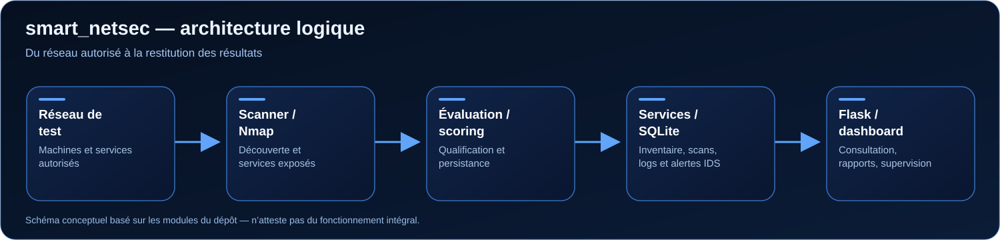

<div align="center">

# smart_netsec

**Plateforme de supervision et d'évaluation de la sécurité réseau**

*Découverte des équipements · Analyse des services exposés · Évaluation des risques · Alertes de sécurité*

[**Voir le code**](https://github.com/imane88-lgtm/smart_netsec) · [**Portfolio d'Imane**](https://imane-mrino-portfolio.argus-codex-ai.chatgpt.site/) · [**Profil GitHub**](https://github.com/imane88-lgtm)

</div>

## 01 — Présentation

**smart_netsec** explore une question centrale en cybersécurité défensive : **comment transformer les informations d'un réseau en signaux de sécurité exploitables ?**

Le projet assemble plusieurs briques techniques pour identifier des équipements accessibles, examiner les services exposés, attribuer des scores de risque, centraliser les résultats et restituer les informations dans une interface web. Il comprend également des modules liés à la journalisation d'événements de sécurité et aux alertes IDS.

Ce travail s'inscrit dans le parcours d'**Imane Mrino**, étudiante en Bachelor Réseaux, Cloud et Cybersécurité, à la suite d'un DUT en Sécurité Informatique et Réseaux. Le projet est associé à son expérience de développement d'une plateforme de sécurité réseau lors d'un stage technique chez **Ménara Préfa (2026)**. Les limites de publication du code et la contribution individuelle doivent être validées avec la structure d'accueil.

### Objectifs

- **Découvrir** les équipements présents dans un périmètre autorisé.
- **Observer** les ports et services exposés.
- **Qualifier** des résultats à l'aide d'une logique de scoring.
- **Centraliser** appareils, scans, alertes et rapports.
- **Visualiser** les événements afin de faciliter l'analyse et le suivi.
- **Expérimenter** l'import d'événements IDS réels ou simulés dans un environnement contrôlé.

## 02 — Fonctionnalités et état de vérification

| Fonctionnalité | Éléments trouvés dans le dépôt | État |
|---|---|---|
| Découverte réseau | `scanner/`, `scan_complet.py`, appels au scan depuis `backend/app.py` | Code présent ; exécution à valider |
| Analyse des ports/services | Scanner Nmap référencé par `scan_complet.py` | Intégration à valider |
| Évaluation des risques | `scoring.py`, données de score exposées au dashboard | Logique présente ; calibration à tester |
| Inventaire et historique | `backend/database/`, SQLite, requêtes de statistiques | Couche présente ; tests à documenter |
| Tableau de bord web | Flask, `frontend/`, `backend/app.py` | Routes et templates présents ; rendu à capturer |
| Alertes IDS Snort | `backend/services/snort_service.py`, watcher et événements de démonstration | Données réelles et simulées à distinguer |
| Lecture de logs Suricata | `suricata_reader.py` : parsing de `eve.json` et stockage SQLite | Module distinct ; intégration complète non confirmée |
| Rapports | `rapport_pdf.py`, route `/generer-rapport` | Code présent ; sortie PDF à tester |
| Supervision locale | `backend/services/monitoring_service.py`, route `/api/supervision` | Code présent ; mesures à valider |
| Firewall/réponse | `backend/api/firewall_api.py`, services de pare-feu | Sensible ; à tester uniquement en labo isolé |

**Important :** la présence d'une fonction ou d'un module dans le dépôt ne constitue pas, à elle seule, une preuve de fonctionnement. Des données injectées pour la démonstration ne doivent jamais être présentées comme des incidents réels.

## 03 — Architecture technique



Le backend Flask expose les fonctionnalités de scan, les statistiques, la consultation des alertes, la supervision et la génération de rapports. La couche de persistance est basée sur SQLite. Les modules IDS incluent du traitement d'alertes Snort et un lecteur Suricata séparé.

### Composants clés

```text
smart_netsec/
├── backend/
│   ├── api/                  # Routes spécialisées (auth, IDS, supervision...)
│   ├── database/             # Accès SQLite et dépôts de données
│   ├── services/             # Logique métier : monitoring, Snort, firewall...
│   ├── utils/                # Authentification et journaux
│   ├── app.py                # Application web et routes principales
│   └── config.py             # Configuration
├── frontend/                 # Interface web et fichiers statiques
├── scanner/                  # Fonctions de découverte et de scan
├── services/                 # Scripts et composants complémentaires
├── scoring.py               # Évaluation des risques
├── scan_complet.py          # Orchestration du parcours de scan
├── suricata_reader.py       # Lecture expérimentale de eve.json
├── rapport_pdf.py           # Génération de rapports
├── requirements.txt         # Dépendances Python
└── run.py                   # Lanceur actuel
```

*Arborescence volontairement condensée pour présenter les modules utiles à l'analyse. Le dépôt contient également des sauvegardes et fichiers techniques à nettoyer.*

## 04 — Technologies et environnement

| Technologie | Utilisation dans le projet |
|---|---|
| **Python 3** | Développement des modules de sécurité et de supervision |
| **Flask** | Routes web et API |
| **SQLite** | Stockage local des résultats et alertes |
| **Nmap** | Analyse de services via le composant scanner (binaire système requis) |
| **Snort** | Traitement et suivi de certains événements IDS dans le backend |
| **Suricata / EVE JSON** | Lecteur dédié de journaux, à valider dans le parcours applicatif |
| **HTML / CSS / JavaScript** | Interface de consultation et de pilotage |
| **Linux** | Environnement ciblé par les scripts système et les outils réseau |

Certaines fonctionnalités reposent sur des binaires ou des droits système supplémentaires : **l'installation des dépendances Python ne suffit pas toujours**.

## 05 — Installation (laboratoire uniquement)

> **Précondition de sécurité :** ne pas exposer ce prototype sur Internet ni sur un réseau d'entreprise. Son lanceur actuel utilise une écoute réseau étendue et le dépôt présente des valeurs de configuration de démonstration. Effectuer les tests dans une VM isolée ou après correction de ces paramètres.

### Pré-requis

- Linux et Python 3 avec `pip` et `venv`.
- Git.
- Le binaire Nmap **si** les fonctionnalités de scan sont testées.
- Un périmètre de test explicitement autorisé.
- Les composants IDS Snort/Suricata uniquement pour les scénarios qui en ont besoin.

### Préparer l'environnement

```bash
git clone https://github.com/imane88-lgtm/smart_netsec.git
cd smart_netsec
python3 -m venv .venv
source .venv/bin/activate
python -m pip install -r requirements.txt
```

**Avant le lancement :** supprimer/remplacer les identifiants de démonstration, définir une clé de session robuste, désactiver le mode debug et restreindre l'écoute à `127.0.0.1`. Contrôler également les certificats et clés du répertoire `ssl/`.

Le point d'entrée actuellement présent est :

```bash
python3 run.py
```

Cette commande indique **où démarre l'application dans le code**, pas une garantie que l'ensemble des modules démarrera sans modification. Le lanceur peut démarrer en HTTPS si des certificats sont disponibles ; les messages et paramètres codés en dur doivent être révisés avant une démonstration.

### Problèmes d'intégration à connaître

- `scan_complet.py` attend une plage réseau en arguments dans `scan_complet(ip_debut, ip_fin)`, alors que le lanceur web l'appelle comme script : **le chemin de scan doit être vérifié et corrigé**.
- Le dépôt possède **plusieurs couches / générations de code** ; leurs bases SQLite et formats d'alertes ne sont pas nécessairement interchangeables.
- Certains flux IDS utilisent des **alertes de démonstration** lorsque l'import de logs réels n'aboutit pas.
- Aucun résultat d'exécution end-to-end n'est certifié par cette documentation seule.

## 06 — Scénario de démonstration SOC

**Scénario suggéré, à réaliser et documenter :**

1. Créer un réseau de test isolé comportant une ou deux machines virtuelles autorisées.
2. Identifier les hôtes et vérifier les services réellement exposés.
3. Exécuter le traitement de scoring et expliquer les critères employés.
4. Consulter les résultats dans SQLite et dans le dashboard.
5. Importer **un fichier d'événements de test** au format compatible, puis comparer les alertes avec la source.
6. Produire un court rapport : observation, preuve, risque, recommandation et limitation.

### Fiche de qualification d'une alerte

| Champ | Ce qu'il faut documenter |
|---|---|
| Contexte | Machine, service et périmètre de test |
| Source | Scan autorisé, Snort, Suricata ou événement simulé |
| Horodatage | Date et heure de l'événement |
| Observation | Ports/services, signature ou anomalie |
| Niveau | Criticité proposée **et justification** |
| Vérification | Éléments confirmant ou infirmant l'alerte |
| Décision | Surveiller, approfondir ou escalader |
| Correctif | Mesure possible et validation après retest |

**Aucune mesure ni capture n'est inventée dans ce README.** Compléter cette partie avec des tests réellement exécutés et des captures anonymisées.

## 07 — Tests et preuves à fournir

| Vérification | Preuve à ajouter | Résultat |
|---|---|---|
| Lancement dans une VM isolée | Capture du terminal + version Python | À réaliser |
| Scan autorisé | Liste d'hôtes/ports avec IP anonymisées | À réaliser |
| Scoring | Exemple entrée → score → justification | À réaliser |
| Persistance | Extrait non sensible de tables SQLite | À réaliser |
| Traitement IDS | Exemple de log réel/simulé clairement identifié | À réaliser |
| Dashboard | Capture fidèle de l'application lancée | À réaliser |
| Rapport PDF | Rapport exemple sur données synthétiques | À réaliser |

Les images de démonstration devront être placées dans `docs/screenshots/` **après validation**, et non remplacées par de faux résultats visuels.

## 08 — Intérêt pour le métier d'analyste SOC

Ce projet contribue à plusieurs compétences recherchées pour un stage **Cybersécurité / SOC chez INOVADEX CONSULTING** :

| Attente du poste | Apport du projet |
|---|---|
| Comprendre les systèmes/réseaux | Découverte de machines et analyse de services |
| Analyser la surface d'exposition | Ports ouverts, scoring, résultats structurés |
| Superviser des événements de sécurité | Dashboard, historique et stockage d'alertes |
| Comprendre les IDS | Modules de lecture et de mise en forme d'alertes |
| Documenter des constats | Rapport, preuves, recommandations et retests à compléter |

Le projet **ne constitue pas** une expérience d'exploitation d'un SOC d'entreprise, ni une preuve de maîtrise de Wazuh, OpenSearch ou Logstash.

## 09 — Limites connues et prochaines améliorations

**Priorité sécurité avant publication/démonstration :**

- Supprimer les identifiants de démonstration affichés dans `run.py` et revoir les comptes créés à l'initialisation.
- Supprimer les secrets de repli codés en dur (`backend/config.py`) et utiliser exclusivement des variables d'environnement.
- Définir `DEBUG=false`, restreindre l'hôte réseau et sécuriser les sessions.
- Examiner `ssl/`, les bases de données, les fichiers de sauvegarde et l'historique Git à la recherche d'informations sensibles.
- Vérifier les autorisations de publication du code de stage et anonymiser les éléments d'infrastructure.
- Corriger les scripts de scan pour séparer configuration réseau, logique et interface.

**Développement technique souhaité :**

- Tests unitaires des règles de scoring et du parsing IDS.
- Jeux de données synthétiques reproductibles.
- Distinction systématique entre alertes réelles et démonstrations.
- Workflow d'alerte documenté : triage, faux positifs, escalade et retest.
- Journalisation structurée et gestion explicite des erreurs.

## 10 — Autrice et liens

**Imane Mrino** — Étudiante en Réseaux, Cloud et Cybersécurité · Orientation SOC / Blue Team

[GitHub](https://github.com/imane88-lgtm) · [LinkedIn](https://www.linkedin.com/in/imane-mrino-899749373/) · [Portfolio](https://imane-mrino-portfolio.argus-codex-ai.chatgpt.site/)
